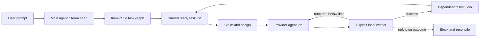

# Execution graphs and shared teams

Callers: `SKILL.md`, `control-center/cli.js`, `control-center/server.js`.
Runtime: `control-center/graph-runtime.js`; provider execution remains in
`process-manager.js`. No graph framework, decision service or new credentials.
Continue with [harness.md](harness.md) for policies, bounded observations and
recovery reports around this graph runtime.

## Operating model

The calling main agent is Team Lead: translate the user's authorized goal into
a versioned graph, declare teammates, assign bounded tasks and inspect results.
The local scheduler claims ready tasks and launches real provider jobs or local
checks. A team member is a coordination role with optional routing/expert/notebook
defaults. It is not an additional credential, persistent chat context or running
process. An explicit lead task can run through the same normal job adapter.

The definition is immutable after creation. Review the complete goal, prompts,
commands, workspace and routing, then start with its exact `definitionHash`.
This is a machine integrity gate; existing user authorization does not require
another human approval round. Dynamic expansion needs a new reviewed definition.
Do not mistake a skill instruction for a callable runtime capability: these
commands require a server running this package version.



## Version 1 schema

```json
{
  "version": 1,
  "name": "Scoped implementation",
  "goal": "Implement the authorized change and verify its acceptance checks",
  "sourceKey": "issue:42:revision:3",
  "team": {
    "lead": "lead",
    "members": [
      {"id": "lead", "taskClass": "planning"},
      {"id": "builder", "taskClass": "code"},
      {"id": "reviewer", "taskClass": "code"}
    ]
  },
  "nodes": [
    {"id": "ready", "type": "check", "command": ["npm", "test"]},
    {
      "id": "build", "type": "loop", "assignee": "builder",
      "prompt": "Implement the scoped change; preserve unrelated edits.",
      "maxAttempts": 2,
      "check": {"command": ["npm", "test"], "timeoutMs": 60000}
    },
    {"id": "review", "type": "agent", "assignee": "reviewer", "prompt": "Review the actual changes against the user goal and report concrete findings."}
  ],
  "edges": [
    {"from": "ready", "to": "build", "on": "failure"},
    {"from": "build", "to": "review", "on": "success"}
  ]
}
```

The leading check must actually establish the requested result. A generic test
suite passing does not prove a missing feature was implemented. Replace it with
an acceptance check that fails until the requested artifact or behavior exists.
With a sound leading check, already-satisfied work makes zero provider calls.
The prompt shortcut creates one loop and verifies **after** its first agent job.

| Element | Contract |
|---|---|
| `agent` | Required prompt; one ordinary job. Process completion settles the node; it is not proof of semantic correctness. |
| `check` | Required nonempty `command` argv; exit 0 succeeds, integer nonzero fails. |
| `loop` | Required prompt, check and `maxAttempts` 1–5. Only a completed agent followed by a nonzero check can cause another agent attempt. |
| `join` | Default `all`; `any` accepts any selected incoming edge after **all** parents have settled. |
| Edge `on` | `success`, `failure` or `always`. Skipped parents activate no edge, including `always`. |
| Routing | Agent/loop node may set `agent`, `taskClass`, `expert`, `notebookId`; overrides the claimant's defaults. Notebook ids are resolved again before each launch. |
| `harness` | Optional immutable policy object: `maxAgentAttempts`, `maxElapsedMs`, `maxConcurrentTasks`; see [harness.md](harness.md). |
| `cwd` | Optional on any task; real directory must remain within the server workspace, including symlinks. |
| Team | 1–24 unique members; declared lead; optional label and routing defaults. Missing team defaults to `lead` and `worker`; prompt shortcut assigns `worker`. |
| Bounds | 1–24 tasks, ≤96 edges, acyclic graph, ≤36,000-byte definition, goal plus each prompt ≤25,000 bytes, ≤20 retained runs, ≤4 MiB checkpoint. |

Two graph tasks may be active at once across nonterminal runs. Each teammate
owns at most one busy task per run. A larger declared team does not raise
concurrency. Provider jobs also obey the existing JobManager capacity; full
capacity waits for the regular scheduler turn without consuming an attempt.
Standalone checks can run alongside independent provider work.
Harness policy may lower per-graph concurrency and pause dispatch on time or
attempt limits. An agent-attempt pause still admits already-earned loop checks;
manual pause and time expiry stop all new dispatch.
The 20-run retention limit counts terminal runs too; there is no prune/delete
command in version 1. This is a bounded local workflow store, not an unlimited
event archive.

## Claims and communication

```bash
route3-skill graphs create --file graph.json
route3-skill graphs tasks <id>
route3-skill graphs members <id>
route3-skill graphs claim <id> --node ready --member lead
route3-skill graphs message <id> --from lead --to builder --task build --text "Preserve the public API."
route3-skill graphs start <id> --hash <definitionHash>
route3-skill graphs wait <id>
```

Claim only a ready pending task in a draft, paused or running graph. An assignee
restricts the claimant. Only its owner can release a claim, and only before
dispatch. Unclaimed ready tasks are assigned by the scheduler, preferring a free
non-lead member. Claims are serialized in one manager; checkpoint ownership
prevents competing servers from writing the same queue.

Messages require declared sender/recipient (`team` broadcasts), at most 1,000
characters and an optional known task id. The last 50 are retained. Up to five
relevant messages plus bounded dependency/check receipts enter the **next** task
brief. They are data, cannot expand authorization and are not delivered into a
job already running. Member ids label coordination roles; the existing localhost
token is the access boundary, not separate per-member authentication.

Each task/attempt starts a fresh provider job with a bounded brief, rather than
accumulating every teammate transcript. Providers retain their configured
models, credentials and permission behavior. Approval requests remain visible
through normal jobs; graph polling never approves them.

## Local decisions and unchanged triggers

The scheduler computes dependency readiness and team availability without LLM
calls. No draft, empty scheduler or terminal graph dispatches provider work.
An optional stable `sourceKey` identifies a source **revision**: identical
normalized definitions return the existing run; different work under that key
conflicts. This applies to terminal runs too. Use a new revision for changed work;
do not rotate keys on every poll. There is no automatic deletion or paid retry.

This implements the applicable local part of the supplied
[loop-engineering post](https://x.com/beamnxw/status/2108101310515925217): deterministic
triggers and bounded decisions before additional model work. No Jev service or
SDK is installed; this is separate from local code search/Jevgrep. There is no
measured cost-reduction percentage from these functional tests.

## Lifecycle, verification and recovery

Create → `draft`; exact hash start → `running`. Pause stops **new** dispatch;
already-running work may finish and its result is recorded. Resume works only
from `paused`. Cancellation stops owned checks and the current provider failover
successor; it does not undo side effects. Disk failure is still reported even
when cancellation has been attempted successfully.

Known agent failure stops that task without a loop retry. The graph follows
JobManager's existing provider failover links rather than launching its own
fallback. A check timeout, signal, missing executable, output overflow or missing
exit status blocks the graph; none authorizes another execution attempt.
Checks use `shell: false`, default timeout 20 s (100 ms–60 s allowed), at most
64 KiB output and a redacted 2,000-character receipt. Stop targets the owned
process group, with TERM then KILL. An explicitly invoked shell or a check's own
program can still perform side effects: choose checks appropriate to the scope.
These workspace and argv rules are not an OS sandbox.

When all tasks settle, an unhandled failed task makes the graph `failed`.
A successful direct `failure`/`always` handler can handle its parent's failure;
the graph can then succeed with failed task receipts and a warning note. Inspect
those receipts. An agent-only review node reports findings in its job log; its
process exit does not automatically interpret those findings as a failed review.

With production persistence enabled, each transition is written atomically to a
private workspace-keyed checkpoint before dispatch. File contents and POSIX
directory metadata are synced before proceeding. Normal mode is 0600, directory
creation 0700. One exclusive pid/token lock owns the file. A dead owner may be
reclaimed under a separate recovery guard; corrupt locks or an abandoned
`.lock.recovery` fail closed and require inspection while all managers are stopped.
Do not delete a live owner's lock. A storage error latches new dispatch; closing
and reopening requires reconciling disk and actual jobs first.

On restart, completed prefixes remain. Undispatched claims are released;
intact runs pause for explicit resume. Active checks, missing/interrupted jobs
and unknown dispatch outcomes become `blocked` and are never blindly replayed.

```bash
route3-skill graphs show <id>
route3-skill jobs list
route3-skill graphs reconcile <id> --node build --action attach --job <job-id> --note "Verified the saved dispatch marker and actual job"
# OR explicitly record that the uncertain task failed:
route3-skill graphs reconcile <id> --node build --action fail --note "No trustworthy outcome is available"
route3-skill graphs resume <id>
```

Attachment requires the saved attempt marker at the start of the job summary,
matching workspace and a non-interrupted job not owned by another task. Failing
an uncertain task records a failure; it does not rerun it. A subsequent failure
branch may execute only when the reconciled graph is explicitly resumed.

## HTTP contract

`GET /api/graphs` returns `{graphs}` summaries; `GET /api/graphs/:id` returns
`{graph}` with full definition, task states, claims, messages and receipts.
`POST /api/graphs` accepts `{definition}` or a prompt plus `command`, optional
`maxAttempts`, routing, `cwd` and `sourceKey`. Creation returns 201 and `{graph}`.
Actions under `/api/graphs/:id/` return `{graph}`:

| Action | Body |
|---|---|
| `start` | `{definitionHash}` |
| `pause`, `resume`, `cancel` | `{}` |
| `claim`, `release` | `{nodeId, memberId}` |
| `message` | `{from, to, body, taskId?}` |
| `reconcile` | `{nodeId, action: "attach" or "fail", note, jobId?}` |

Existing localhost Host/Origin checks, mutation token and 40,000-byte JSON body
limit apply. Use the CLI client to handle bootstrap/token exchange. Checkpoint
failures are visible in `/api/state` warnings; unsafe-to-open storage returns 503
for graph operations and leaves independent jobs available. Do not start a
second server as a workaround for an uncertain graph.
